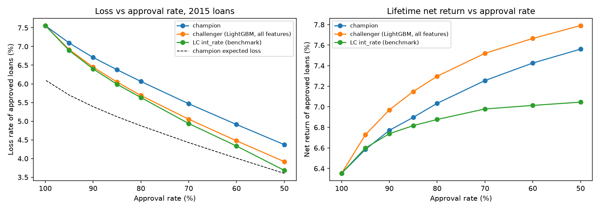
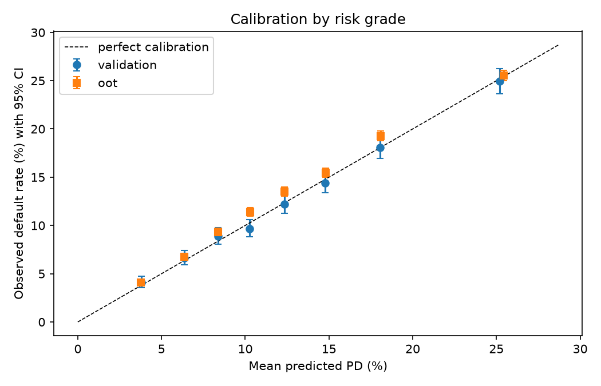
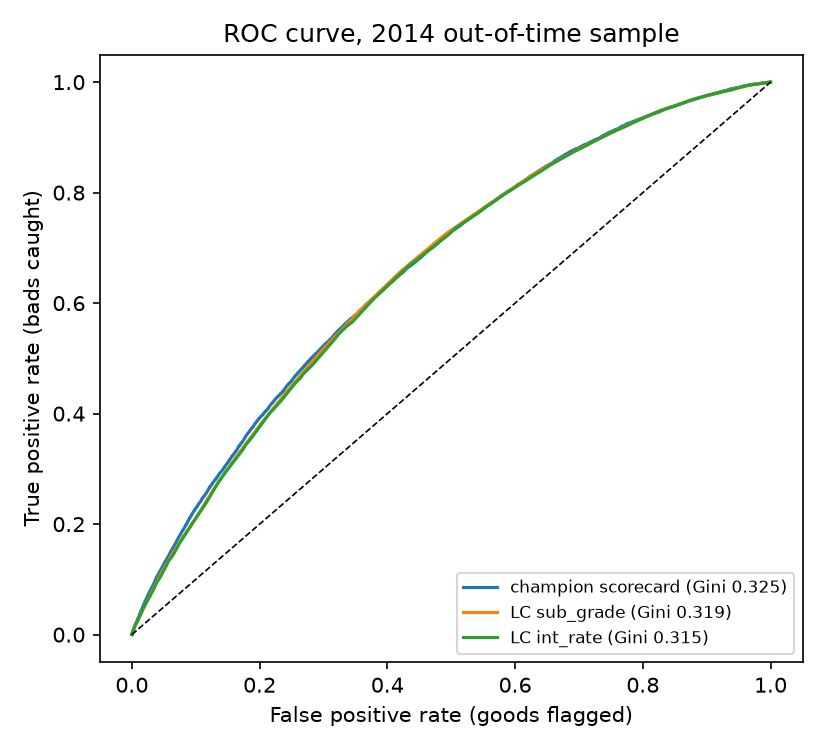

# Credit Default Model: Development, Validation and Monitoring

**Question:** can an interpretable scorecard built only on application data predict which consumer loans will default — and would routine monitoring have caught it when its predictions stopped being reliable?

**Headline finding:** a 13-feature logistic scorecard ranks risk as well as Lending Club's own grade on 2014 loans (Gini 0.326 vs 0.319, DeLong p = 0.08) and keeps that ranking through 2015. But quarterly monitoring of 2015 shows its **predicted default rate is 11–18% too low in every quarter**, although the applicants look unchanged on paper. For the 2015 portfolio this understates losses by **$53M (24%)** on $3.6bn of loans.

**Recommendation:** keep the scorecard for approval decisions (declining the riskiest 15% would have raised lifetime return from 6.35% to 6.90%), correct its loss estimates with a documented overlay now, and redevelop it on recent loans.

➡️ One-page summary for non-technical readers: [reports/model_memo.md](reports/model_memo.md) · Technical details: [reports/validation_report.md](reports/validation_report.md) · All decisions and alternatives: [reports/decision_log.md](reports/decision_log.md)

---

## Key figures

| Monitoring 2015: stable inputs and ranking, failing calibration | Business impact: approval rate vs loss and return |
|---|---|
|  |  |

| Calibration by risk grade (validation vs 2014) | ROC curve vs Lending Club benchmark (2014) |
|---|---|
|  |  |

## What the project covers

| Step | What was done | Notebook |
|---|---|---|
| Data & definitions | Default definition, outcome maturity, 151-column leakage audit, data-quality checks, development window moved to 2012-Q4 after finding a feature rollout | [01](notebooks/01_data_quality_and_target.ipynb) |
| Development | WoE binning (monotonic), IV/correlation/VIF selection, logistic regression, points scaling | [02](notebooks/02_scorecard_development.ipynb) |
| Validation | Out-of-time Gini with bootstrap CIs, DeLong tests, binomial & Jeffreys calibration tests, LightGBM challenger, SHAP | [03](notebooks/03_validation_and_challenger.ipynb) |
| Monitoring | Quarterly PSI/CSI, back-testing, RAG thresholds set in advance, recalibration test, root-cause investigation, SQL cross-check | [04](notebooks/04_monitoring.ipynb) |
| Business impact | Empirical LGD/EAD, expected vs realised loss, approval cutoffs, net return, champion–challenger swap set | [05](notebooks/05_business_impact.ipynb) |

Rendered versions without running code: [reports/html](reports/html).

## Results at a glance

| | Value |
|---|---|
| Loans (36-month, individual) | 115,603 development · 162,570 out-of-time (2014) · 282,848 monitoring (2015) |
| Gini: validation / 2014 / 2015 quarters | 0.326 / 0.326 / 0.33–0.35 |
| Mean PD vs observed default rate, 2015 | 12.6–13.3% vs 14.6–15.4% |
| Gini gain of LightGBM challenger (all features) | +3.8 points (95% CI +3.4 to +4.3) |
| LGD / EAD factor (development defaults) | 0.89 / 0.57 |
| 85% approval vs approve all (2015) | loss rate 6.38% vs 7.56%; net return 6.90% vs 6.35% |

## How to reproduce

```bash
python -m venv .venv && source .venv/bin/activate
pip install -r requirements.txt
# Kaggle API token in ~/.kaggle/access_token (https://www.kaggle.com/settings/api)
python run_all.py          # tests, download (~1.3 GB), extract, notebooks 01–05 (~2 min after download)
python run_all.py --html   # additionally export reports/html
```

A full rerun reproduces every table in `reports/` exactly.

## Repository structure

```text
├── run_all.py            one-command pipeline
├── sql/                  DuckDB extraction, data-quality views, monitoring layer
├── src/                  config & column audit, data prep, features, scorecard, challenger,
│                         validation statistics, monitoring/RAG, business impact
├── notebooks/            01–05, the analysis narrative
├── tests/                unit tests for Gini, KS, PSI, DeLong, binomial/Jeffreys, Hosmer–Lemeshow
└── reports/              memo, validation report, decision log, result tables, figures, html
```

## Limitations

- Public US peer-to-peer lending data; not representative of any specific bank's portfolio.
- Lifetime (36-month) default rather than the 12-month PD used for regulatory capital.
- Only accepted loans are observed (no reject inference).
- Statistical tests assume independent defaults; real defaults are correlated.
- LGD/EAD are portfolio averages; returns exclude funding, servicing and capital costs.
- No protected-characteristic data: potential proxies (location) were excluded, but outcome fairness could not be tested.

## Data

Lending Club accepted loans 2007–2018Q4, via Kaggle dataset `wordsforthewise/lending-club` (CC0). Data files are not committed; `run_all.py` downloads them.

**Author:** Savelii Seliaev · [LinkedIn](https://www.linkedin.com/in/savelii-seliaev/) · seliaevsava@gmail.com
