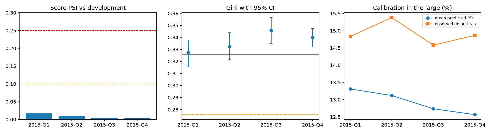

# Credit default model: development, validation and monitoring

I built a credit scorecard for 36-month consumer loans using public Lending Club data (2012–2015), then validated it on later loans and simulated a year of quarterly monitoring, as if it had gone into use at the start of 2015.

The main things I found:

- The scorecard (13 features, logistic regression on WoE bins) ranks borrowers about as well as Lending Club's own sub-grade on 2014 loans: Gini 0.326 vs 0.319, not a significant difference (DeLong p = 0.08). The ranking holds up through 2015.
- Its predicted default rate does not hold up. In every quarter of 2015 actual defaults were 11–18% higher than predicted, even though the input data looked stable (PSI below 0.02). The stability checks would have looked fine; only back-testing against outcomes shows the problem.
- For the 2015 loans ($3.6bn) this means expected loss was $221M against $274M actually lost.
- Using the score to decline the riskiest 15% of applications would still have cut the loss rate from 7.6% to 6.4% and raised lifetime return from 6.35% to 6.90%.

My conclusion is that the scorecard is fine for ranking applicants but its loss estimates need a correction, and it should be redeveloped on more recent loans. A LightGBM challenger with all available features ranks better (+3.8 Gini points), mostly because it uses information the scorecard left out.

There is a one-page summary written for a non-technical audience in [reports/model_memo.md](reports/model_memo.md), and the full technical write-up in [reports/validation_report.md](reports/validation_report.md).




## Notebooks

1. [Data quality and target definition](notebooks/01_data_quality_and_target.ipynb): default definition, which columns would leak the outcome, missing data. I moved the start of the development sample to 2012-Q4 after finding that many credit-bureau fields were only collected from late 2012.
2. [Scorecard development](notebooks/02_scorecard_development.ipynb): binning, feature selection, logistic regression, points.
3. [Validation and challenger](notebooks/03_validation_and_challenger.ipynb): out-of-time performance on 2014, comparison with Lending Club's grade, calibration tests (binomial, Jeffreys), LightGBM challenger.
4. [Monitoring](notebooks/04_monitoring.ipynb): quarterly checks on 2015 with thresholds fixed beforehand, and an investigation of why the default rate was underestimated.
5. [Business impact](notebooks/05_business_impact.ipynb): loss given default, expected vs actual loss, approval cutoffs.

## Running it

```bash
python -m venv .venv && source .venv/bin/activate
pip install -r requirements.txt
python run_all.py
```

`run_all.py` needs a Kaggle API token in `~/.kaggle/access_token`. It runs the unit tests, downloads the data (about 1.3 GB), and executes the notebooks in order, which takes about two minutes after the download.

Code is in `src/` (Python) and `sql/` (DuckDB queries for extraction, data quality and monitoring). Result tables and figures are in `reports/`.

## Limitations

- Lending Club is a US peer-to-peer lender, so none of this transfers directly to a bank's own portfolio.
- The target is default over the full 36-month term, not the 12-month horizon used for regulatory PD models.
- Only approved loans are in the data, so nothing can be said about applicants Lending Club rejected.
- The statistical tests assume defaults are independent, which they are not in reality.
- Loss and return figures ignore funding, servicing and capital costs.
- The data has no protected characteristics, so I excluded location fields as possible proxies but could not test the outcomes for fairness.

## Data

Lending Club accepted loans 2007–2018Q4 from the Kaggle dataset `wordsforthewise/lending-club` (CC0). The data is not included in the repository.

Savelii Seliaev · [LinkedIn](https://www.linkedin.com/in/savelii-seliaev/)
